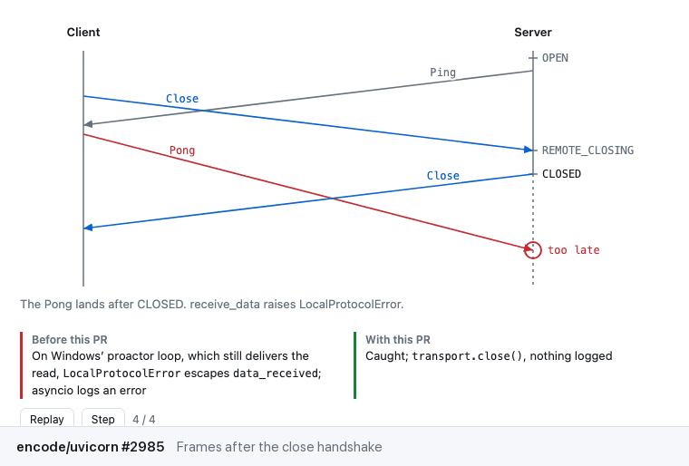

# teach-me

Ask Claude Code to explain the ideas behind a code change, and get a short lesson with a diagram
you can play with and a quiz. It works on your pull requests, anyone's public pull request, your
uncommitted changes, or an idea you describe.

[](LICENSE)

<picture>
  <source media="(prefers-color-scheme: dark)" srcset="docs/demo-dark.gif">
  
</picture>

Diagrams teach-me drew for [encode/uvicorn#2985](https://github.com/encode/uvicorn/pull/2985),
[redis/hiredis#1375](https://github.com/redis/hiredis/pull/1375),
[sindresorhus/p-queue#244](https://github.com/sindresorhus/p-queue/pull/244) and
[pallets/flask#5818](https://github.com/pallets/flask/pull/5818).

When a change leans on something you haven't worked with, like a protocol rule, a data structure
or a new way of passing state around, you have to learn that first before you can judge the
change. teach-me helps with that part. It picks the one to three ideas a reviewer needs, and explains
each one with a short lesson, a diagram drawn from the change's own code, and a couple of quiz
questions. Before you see anything, a separate agent checks every explanation against the code as
an adversarial pass and fixes errors it finds. The page is saved as a private Artifact in your Claude account.

It only runs when you type `/teach-me`. Claude won't start it on its own.

## Where it comes from

teach-me comes out of the [Learn tab](https://github.com/sshah03/perspica#learn) in
[perspica](https://github.com/sshah03/perspica), a semantic code review tool. Getting those lessons right
took a lot of rounds. We wrote them for about thirty real pull requests, checked the diagrams vs.
the code (sometimes by building and running it), and compared versions side by side
without knowing which was which. That helped determine what makes a diagram clear and a quiz useful,
and what makes them cluttered or wrong (at least in our opinion).

This plugin packages what came out of that, so anyone can use it without installing perspica.
You get the same kind of lessons, diagrams and quizzes as a Claude Artifact, for any pull request
or idea. If you also want the full semantic review (changes in reading order, mechanical edits set aside,
notes on what to check before merging), that's what perspica is for.

## Install

You need [Claude Code](https://claude.com/claude-code) and Python 3.9 or newer, which most Macs
and Linux machines already have. To read pull requests it uses the GitHub CLI, so install
[gh](https://cli.github.com) and run `gh auth login` once.

The easy way is to let Claude do it. Start Claude Code and paste this in:

```
Install the teach-me skill from https://github.com/sshah03/teach-me. Follow the repo's AGENTS.md.
```

To do it yourself instead, type these two lines into Claude Code, one at a time:

```
/plugin marketplace add sshah03/teach-me
/plugin install teach-me@teach-me
```

Then start a new Claude Code session, and `/teach-me` is ready.

To update it later, type `/plugin marketplace update teach-me`, then
`/plugin update teach-me@teach-me`. To remove it, type `/plugin uninstall teach-me@teach-me`.

## Use

```
/teach-me
/teach-me 123
/teach-me encode/uvicorn#2985
/teach-me https://github.com/pallets/flask/pull/5818
/teach-me my uncommitted changes
/teach-me the last commit
/teach-me how a Bloom filter answers "maybe"
```

With nothing after it, teach-me uses the pull request for your current branch, or your
uncommitted changes if there isn't one. A number is a pull request in the repo you're in.

Claude tells you which ideas it picked, then writes the page. In testing that took about one to two
minutes with Sonnet and five or six with Opus. Each idea
gets:

- one sentence on what it is and why it matters here
- a plain explanation for someone meeting it for the first time, then a more detailed one
- a diagram or animation of this change's own code, which you can step through or change
- what to check in this change
- a quiz, with why each answer is right or wrong

When a change has nothing new to learn, like a rename or a formatting pass, it says so instead of
making a page. Without the Artifact tool, the page is saved as an HTML file and Claude tells you
where.

## How it checks

Each lesson goes to a second agent with a checklist. It reads the code, searches the repo and runs
small pieces of it where it can, then fixes what's wrong in place: numbers that don't match the
code, "always" or "never" claims the code doesn't support, the old behavior described wrong, a quiz
answer that disagrees with the diagram. If a browser is available, the diagrams are also drawn at
desktop and phone width to catch text that overlaps or gets cut off.

In testing, this pass caught things like a lesson saying a loop "spins forever" when the loop
actually exits once the connection finishes. It found that by reading the loop's exit conditions.

## What it can't do yet

- It checks claims against code it can read and run. Behavior that depends on something it can't
  run, like a particular terminal or operating system, can still slip through. Read the lesson's
  caveats before relying on a detail.
- It picks at most three ideas per change, so a big pull request gets the most important ones.
- Pull requests in private repos need `gh` access to that repo.
- I've tested it in Claude Code on a Mac with Opus, Sonnet and Haiku, and on Linux and Windows with
  Haiku. If something breaks, please [open an issue](https://github.com/sshah03/teach-me/issues).
- Each page runs a few agents, one to write each lesson and one to check it, so it uses more of
  your plan than a normal question.

## More

- [SKILL.md](.claude/skills/teach-me/SKILL.md): the steps Claude follows
- [references](.claude/skills/teach-me/references): how it picks ideas, writes lessons, draws
  diagrams and checks them
- [AGENTS.md](AGENTS.md): install steps for Claude, and notes for working on the repo

## License

[MIT](LICENSE)
